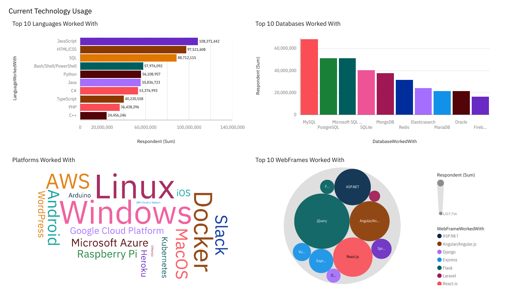
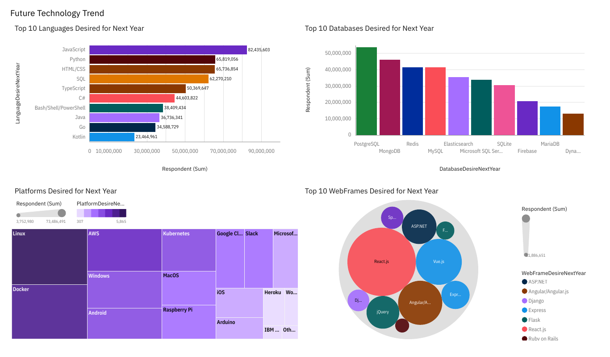
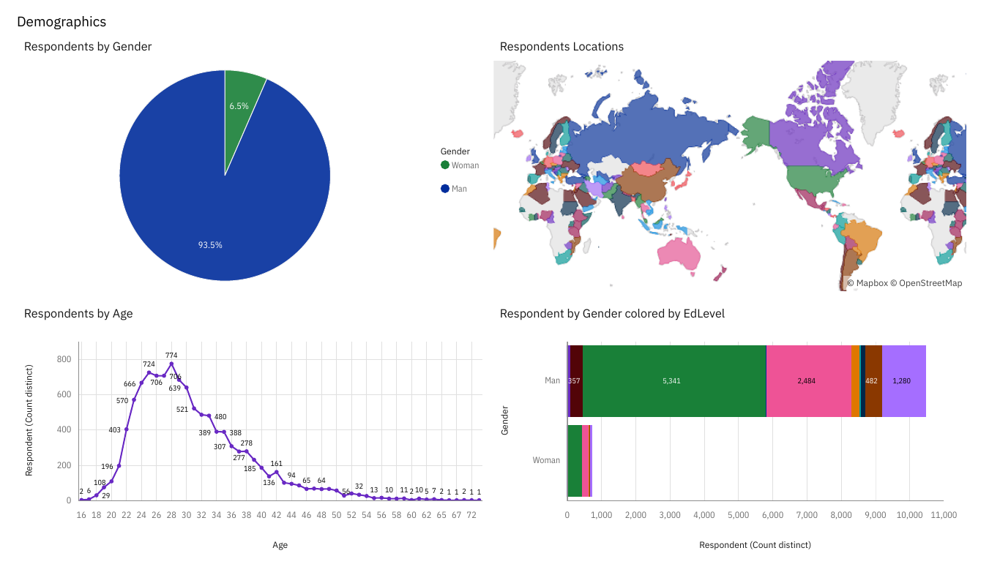

# IBM Data Analyst Capstone: Developer Technology Trends

End-to-end analysis of a developer survey of 11,398 respondents: collecting data from an API and the web, cleaning and wrangling it, exploring it with Python and SQL, and presenting the findings in an IBM Cognos Analytics dashboard. Completed for the [IBM Data Analyst Professional Certificate](https://www.coursera.org/professional-certificates/ibm-data-analyst) (April 2024).

**Tools:** Python (pandas, Matplotlib, Seaborn), SQL (SQLite), IBM Cognos Analytics, Jupyter, REST APIs, BeautifulSoup

## Dashboard

### Current technology usage

### Future technology trends

### Demographics

The full dashboard is in [IBM Capstone Dashboard.pdf](IBM%20Capstone%20Dashboard.pdf).

## Key findings

- **JavaScript, HTML/CSS, and SQL** are the most-used languages today. Next year, **Python** moves up to second, ahead of HTML/CSS, and **TypeScript and Go** gain ground.
- **MySQL** leads current database use; **PostgreSQL** is the most-wanted database for next year, followed by MongoDB and Redis.
- **Linux, Windows, and Docker** dominate current platforms, and container and cloud platforms (Docker, AWS, Kubernetes) feature strongly in what developers want to use next.
- **React.js** is the most-desired web framework for next year.
- Respondents are **93.5% men and 6.5% women**, and most are in their mid-20s to early 30s.

## Notebooks

| Notebook | What it covers |
|---|---|
| [M1ExploreDataSet-lab.ipynb](M1ExploreDataSet-lab.ipynb) | First look at the survey: shape, data types, and key columns |
| [Collecting_Jobs_data_Using_API-Questions.ipynb](Collecting_Jobs_data_Using_API-Questions.ipynb) | Collecting job-posting counts by technology and location from a REST API and saving them to Excel |
| [M2DataWrangling-lab.ipynb](M2DataWrangling-lab.ipynb) | Removing duplicates, imputing missing values, and normalizing data |
| [M3ExploratoryDataAnalysis-lab.ipynb](M3ExploratoryDataAnalysis-lab.ipynb) | Distributions, outliers, and correlations |
| [M4DataVisualization-lab.ipynb](M4DataVisualization-lab.ipynb) | SQL queries against the survey database and charts of distribution, relationship, composition, and comparison |

Supporting labs on web scraping and building a jobs API are in [extras/](extras/).

## Data

`m5_survey_data_demographics.csv` and `m5_survey_data_technologies_normalised.csv` are the survey extracts provided by the course and used for the dashboard.
